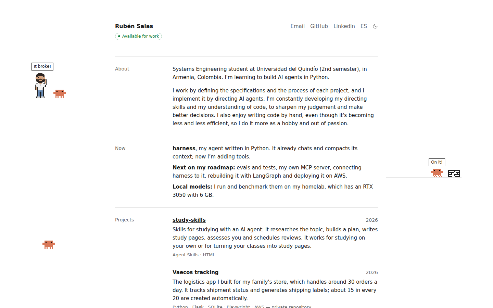

<p align="center">
  
</p>

<h1 align="center">rubensalas.dev</h1>

<p align="center">
  My online résumé, in Spanish and English.<br>
  <a href="https://rubensalas.dev/en/">rubensalas.dev</a> · <code>curl https://rubensalas.dev/en</code> · <a href="README.md">Español</a>
</p>

<p align="center">
  <picture>
    <source media="(prefers-color-scheme: dark)" srcset=".github/readme/en-dark.png">
    
  </picture>
</p>

I'm Rubén Salas, a Systems Engineering student at Universidad del Quindío in Armenia, Colombia. This repository holds the code of my portfolio.

## What's in it

- **Two languages.** Spanish lives at the root (`/`) and English under `/en/`.
- **My projects, my tech stack and what I'm doing now**, on a single page.
- **Articles** in Markdown, with RSS (`/rss.xml` and `/en/rss.xml`).
- **A pixel art scene** that shows how I work: I build by directing AI agents.
- **Light and dark mode.**
- **Terminal version.** Open the site with `curl`, `wget`, HTTPie or `xh` and you get the home page as colored text.
- **`/llms.txt`**, a plain-text summary of the site for language models.

## How I build it

The site is made with [Astro](https://astro.build) and deployed on [Vercel](https://vercel.com). I build it by directing AI agents: I decide what the site says and how it looks, and the agents implement it.

- `AGENTS.md` holds the rules the agents follow when they change the site.
- The technical reasons behind each decision are in the code comments.

## Run it locally

You need Node.js 22.12 or newer.

```sh
npm install
npm run dev
```

The site runs at `http://localhost:4321`.

| Command           | What it does                                     |
| :---------------- | :----------------------------------------------- |
| `npm run dev`     | Starts the site locally and reloads on changes   |
| `npm run build`   | Builds the final site into `dist/`               |
| `npm run preview` | Serves the output of `npm run build` locally     |

## Where things are

| Path                    | Contents                                          |
| :---------------------- | :------------------------------------------------ |
| `src/i18n/ui.ts`        | Every interface text, in both languages           |
| `src/data/projects.ts`  | My projects, in the order they appear on the page |
| `src/data/skills.ts`    | The tech I use and what I'm learning              |
| `src/content/articles/` | My articles, one folder per article               |
| `src/components/`       | The building blocks of the page                   |
| `src/scripts/`          | The pixel art scene                               |
| `public/`               | Icons, share image and static files               |
| `vercel.json`           | The rules that serve the terminal version         |

## Deploying

Vercel deploys whatever is on the `main` branch on GitHub. A change that only exists on my machine doesn't reach the site until I `git push` it.

## Contact

- Email: [rubensalas0907@gmail.com](mailto:rubensalas0907@gmail.com)
- GitHub: [ruben-salas20](https://github.com/ruben-salas20)
- LinkedIn: [ruben-salas17](https://www.linkedin.com/in/ruben-salas17/)
