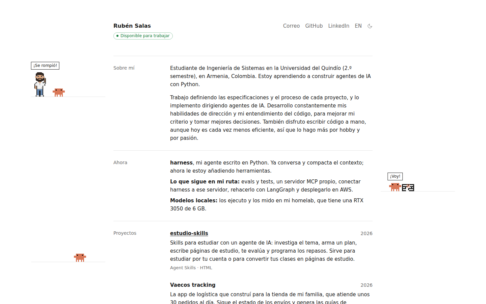

<p align="center">
  
</p>

<h1 align="center">rubensalas.dev</h1>

<p align="center">
  Mi hoja de vida en línea, en español y en inglés.<br>
  <a href="https://rubensalas.dev">rubensalas.dev</a> · <code>curl rubensalas.dev</code> · <a href="README.en.md">English</a>
</p>

<p align="center">
  <picture>
    <source media="(prefers-color-scheme: dark)" srcset=".github/readme/es-dark.png">
    
  </picture>
</p>

Soy Rubén Salas, estudiante de Ingeniería de Sistemas en la Universidad del Quindío, en Armenia, Colombia. Este repositorio es el código de mi portafolio.

## Qué tiene

- **Dos idiomas.** El español vive en la raíz (`/`) y el inglés en `/en/`.
- **Mis proyectos, mis tecnologías y en qué ando ahora**, en una sola página.
- **Artículos** en Markdown, con RSS (`/rss.xml` y `/en/rss.xml`).
- **Una escena en pixel art** que ilustra cómo trabajo: dirijo agentes de IA para construir.
- **Modo claro y oscuro.**
- **Versión de terminal.** Si abres el sitio con `curl`, `wget`, HTTPie o `xh`, recibes la portada en texto con colores.
- **`/llms.txt`**, un resumen del sitio en texto plano para modelos de lenguaje.

## Cómo lo construyo

El sitio está hecho con [Astro](https://astro.build) y se publica en [Vercel](https://vercel.com). Lo construyo dirigiendo agentes de IA: yo decido qué dice el sitio y cómo se ve, y los agentes lo implementan.

- `AGENTS.md` reúne las reglas que siguen los agentes al cambiar el sitio.
- Los porqués técnicos están en los comentarios del código.

## Probarlo en tu equipo

Necesitas Node.js 22.12 o más reciente.

```sh
npm install
npm run dev
```

El sitio queda en `http://localhost:4321`.

| Comando           | Qué hace                                               |
| :---------------- | :----------------------------------------------------- |
| `npm run dev`     | Arranca el sitio en local y se recarga con cada cambio |
| `npm run build`   | Genera el sitio final en `dist/`                       |
| `npm run preview` | Sirve en local lo que generó `npm run build`           |

## Dónde está cada cosa

| Ruta                    | Contenido                                            |
| :---------------------- | :--------------------------------------------------- |
| `src/i18n/ui.ts`        | Todos los textos de la interfaz, en los dos idiomas  |
| `src/data/projects.ts`  | Mis proyectos, en el orden en que salen en la página |
| `src/data/skills.ts`    | Las tecnologías que uso y las que estoy aprendiendo  |
| `src/content/articles/` | Mis artículos, una carpeta por artículo              |
| `src/components/`       | Las piezas de la página                              |
| `src/scripts/`          | La escena en pixel art                               |
| `public/`               | Iconos, imagen para compartir y archivos estáticos   |
| `vercel.json`           | Las reglas que sirven la versión de terminal         |

## Publicar

Vercel publica lo que está en la rama `main` de GitHub. Un cambio que solo está en mi equipo no aparece en el sitio hasta que lo subo con `git push`.

## Contacto

- Correo: [rubensalas0907@gmail.com](mailto:rubensalas0907@gmail.com)
- GitHub: [ruben-salas20](https://github.com/ruben-salas20)
- LinkedIn: [ruben-salas17](https://www.linkedin.com/in/ruben-salas17/)
