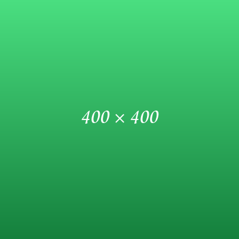

Este artículo no se publica nunca. Sirve para recordar cómo se escribe cada cosa. Cada apartado muestra primero el código y después el resultado.

## Un artículo nuevo

Crea una carpeta en `src/content/articles/` con el nombre que quieras en la URL, y dentro un `es.md` que empiece así:

```markdown
---
title: El título
description: Una línea para la lista, el RSS y los buscadores.
date: 2026-10-12
draft: true
---
```

Con `draft: true` solo se ve en `npm run dev`. Para publicarlo, quita esa línea.

## Versión en inglés

Pon al lado un `en.md` con el mismo formato y el texto en inglés. Las imágenes de la carpeta sirven para los dos. Si la traducción la hizo una IA, añade esta línea al frontmatter y saldrá «Traducido con IA» bajo el título:

```markdown
translatedWithAI: true
```

Cada archivo tiene su propio `draft`: puedes publicar el español y dejar la traducción en borrador.

Si un artículo solo existe en un idioma, la página del otro muestra el texto que hay con un aviso. Esta plantilla solo tiene `es.md`: abre `/en/articles/plantilla/` para ver el aviso.

## Texto

```markdown
Un párrafo con **negrita**, *cursiva*, `código` y un [enlace](https://rubensalas.dev).

Una línea en blanco empieza otro párrafo.
```

Un párrafo con **negrita**, *cursiva*, `código` y un [enlace](https://rubensalas.dev).

Una línea en blanco empieza otro párrafo.

## Subtítulos

```markdown
## Subtítulo

### Subtítulo de segundo nivel
```

El título del artículo ya es el nivel más alto: dentro del texto se empieza por `##`.

### Subtítulo de segundo nivel

Así se ve un `###`.

## Listas

```markdown
- Un punto
- Otro punto

1. Primer paso
2. Segundo paso
```

- Un punto
- Otro punto

1. Primer paso
2. Segundo paso

## Citas

```markdown
> Una cita.
```

> Una cita.

## Bloques de código

Pon el lenguaje después de las tres comillas para que tenga colores:

````markdown
```python
def hola():
    # comentario
    return "hola"
```
````

```python
def hola():
    # comentario
    return "hola"
```

## Imágenes

Guarda la imagen en la carpeta del artículo. El texto entre corchetes describe la imagen para quien no la ve:

```markdown

```


Una imagen más ancha que el texto se reduce para caber; una más pequeña se queda con su tamaño.

## GIF

Igual que una imagen. Sigue animado:

```markdown

```


## Vídeo de YouTube

Pega el enlace solo en una línea. El texto entre corchetes es el título que sale debajo:

```markdown
[Me at the zoo, el primer vídeo de YouTube](https://www.youtube.com/watch?v=jNQXAC9IVRw)
```

[Me at the zoo, el primer vídeo de YouTube](https://www.youtube.com/watch?v=jNQXAC9IVRw)

Sin título, sale «Vídeo de YouTube»:

```markdown
https://youtu.be/jNQXAC9IVRw
```

https://youtu.be/jNQXAC9IVRw

Dentro de una frase no se convierte: [este vídeo](https://youtu.be/jNQXAC9IVRw) sigue siendo un enlace.

## Audio

El archivo va en `public/articulos/<carpeta-del-artículo>/`, no en la carpeta del artículo. Lo que hay en `public/` se publica siempre, aunque el artículo sea borrador.

```html
<audio src="/articulos/plantilla/audio.mp3" title="Tono de prueba de 440 Hz" controls></audio>
```

<audio src="/articulos/plantilla/audio.mp3" title="Tono de prueba de 440 Hz" controls></audio>
